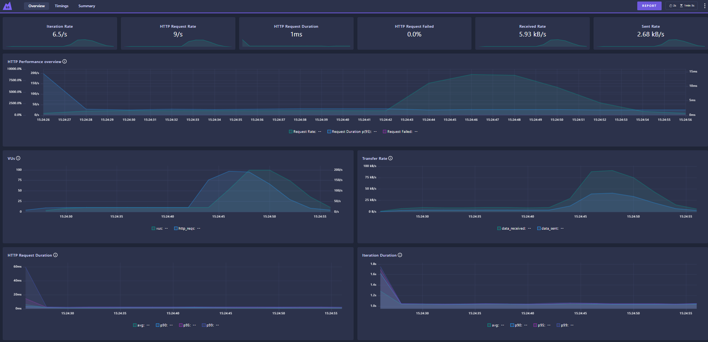

# API de Transferências e Usuários

API Node.js para login, registro, consulta de usuários e transferências, com autenticação JWT e banco de dados em memória.

## Instalação e Execução

1. Instale as dependências do projeto:

```bash
npm install
```

2. Para rodar o servidor REST localmente:

```bash
node server.js
```

3. Para rodar o servidor GraphQL localmente:

```bash
npm run start:graphql
```

## Scripts Úteis

- `npm start` — Inicia o servidor REST
- `npm run start:graphql` — Inicia o servidor GraphQL
- `npm test` — Executa todos os testes automatizados (REST e GraphQL)
- `npm run test-controller-rest` — Executa apenas os testes de controller REST
- `npm run test-external-rest` — Executa apenas os testes de integração/external REST
- `npm run test-controller-graphql` — Executa apenas os testes de controller GraphQL
- `npm run test-external-graphql` — Executa apenas os testes de integração/external GraphQL


## Testes de Performance com K6

O projeto inclui testes de performance utilizando o [K6](https://k6.io/), localizados em `test/rest/external-rest/k6/`. Esses testes avaliam o desempenho dos endpoints de login e registro de usuários, além de permitir cenários avançados como Data-Driven Testing e simulação de múltiplos usuários.

### Estrutura e Conceitos Utilizados

#### 1. **Thresholds**
Permitem definir limites de performance esperados para as requisições.
*Exemplo extraído de `test/rest/external-rest/k6/login.test.js`:*

```js
export let options = {
  thresholds: {
    http_req_duration: ['p(95)<2000'],
    'register_duration': ['p(95)<2000'],
  },
  // ...
};
```

#### 2. **Checks**
Asserções para validar respostas HTTP.
*Exemplo extraído de `test/rest/external-rest/k6/login.test.js`:*

```js
check(res, { 'register status 201': (r) => r.status === 201 });
```
*Garante que o status da resposta do registro seja 201.*

#### 3. **Helpers**
Funções utilitárias reutilizáveis, como `getBaseUrl` e `login`, importadas de outros arquivos.
*Exemplo extraído de `test/rest/external-rest/k6/helpers`:*

```js
import { getBaseUrl } from './helpers/getBaseUrl.js';
import { login } from './helpers/login.js';
```

#### 4. **Trends**
Permitem criar métricas customizadas para monitorar tempos de resposta específicos.
*Exemplo extraído de `test/rest/external-rest/k6/login.test.js`:*

```js
import { Trend } from 'k6/metrics';
const registerDuration = new Trend('register_duration');
registerDuration.add(res.timings.duration);
```
*Monitora a duração das requisições de registro.*

#### 5. **Faker**
Geração de dados dinâmicos e aleatórios para simular usuários reais.
*Exemplo extraído de `test/rest/external-rest/k6/login.test.js`:*

```js
import faker from 'k6/x/faker';
const baseName = faker.person.firstName();
const password = faker.internet.password();
```
*Garante que cada execução utilize dados únicos.*

#### 6. **Variável de Ambiente**
Permite customizar a URL base sem alterar o código.
*Exemplo extraído de `test/rest/external-rest/k6/helpers/getBaseUrl.js`:*

```js
export function getBaseUrl() {
  return __ENV.BASE_URL || 'http://localhost:3000';
}
```

#### 7. **Stages**
Definem o ramp-up, pico e ramp-down de usuários virtuais:
*Exemplo extraído de `test/rest/external-rest/k6/login.test.js`:*

```js
stages: [
  { duration: '3s', target: 10 },
  { duration: '15s', target: 10 },
  { duration: '2s', target: 100 },
  { duration: '3s', target: 100 },
  { duration: '5s', target: 10 },
  { duration: '5s', target: 0 },
],
```
*Simula diferentes cargas de usuários ao longo do teste.*

#### 8. **Reaproveitamento de Resposta**
Utiliza dados de uma resposta (ex: usuário criado) em etapas seguintes.
*Exemplo extraído de `test/rest/external-rest/k6/login.test.js`:*

```js
group('Registrar usuário', function () {
  // ... gera username e registra usuário ...
});
group('Login com reaproveitamento de resposta', function () {
  token = login(username, password);
});
```
*O usuário criado é utilizado imediatamente para login.*

#### 9. **Uso de Token de Autenticação**
O helper de login retorna o token JWT, que pode ser utilizado em requisições autenticadas.
*Exemplo extraído de `test/rest/external-rest/k6/helpers/login.js`:*

```js
export function login(username, password) {
  // ...
  const token = res.json('token');
  return token;
}
```

#### 10. **Data-Driven Testing (DDT)**
Execução de testes com múltiplos usuários a partir de um arquivo de dados.
*Exemplo extraído de `test/rest/external-rest/k6/login.test.ddt.js`:*

```js
import { SharedArray } from 'k6/data';
const users = new SharedArray('users', function () {
  return JSON.parse(open('./data/login.test.data.json'))
});
// ...
const user = users[(__VU - 1) % users.length];
```
*Permite testar cenários variados de login e registro.*

#### 11. **Groups**
Organiza o teste em blocos lógicos, facilitando a leitura e análise dos resultados.
*Exemplo extraído de `test/rest/external-rest/k6/login.test.js`:*

```js
group('Registrar usuário', function () {
  // ...
});
group('Login com reaproveitamento de resposta', function () {
  // ...
});
```

### Comandos para Executar os Testes de Performance

**Com dashboard web e exportação do relatório em HTML:**

```bash
K6_WEB_DASHBOARD=true K6_WEB_DASHBOARD_PERIOD=2s K6_WEB_DASHBOARD_EXPORT=html-report.html k6 run test/rest/external-rest/k6/login.test.js
```

**Sem dashboard:**

```bash
k6 run test/rest/external-rest/k6/login.test.js
k6 run test/rest/external-rest/k6/login.test.ddt.js
```

#### Exemplo de Relatório Gerado



## Endpoints Principais

- `POST /users/login` — Login. Envie `{ "username": "...", "password": "..." }`. Retorna um token JWT.
- `POST /users/register` — Cadastro. Envie `{ "username": "...", "password": "...", "favorecido": true|false }`.
- `GET /users` — Lista usuários (requer autenticação JWT).
- `POST /transfer` — Realiza transferência. Envie `{ "from": "...", "to": "...", "value": 100 }` (requer autenticação JWT).
- `GET /transfers` — Lista transferências (requer autenticação JWT).
- `GET /api-docs` — Documentação Swagger interativa.

## Regras de Negócio

- Login exige usuário e senha válidos.
- Não é permitido registrar usuários duplicados.
- Transferências acima de R$ 5.000,00 só para usuários favorecidos.

## Testes Automatizados

### Testes REST

- **Controller (`test/controller/`)**

  - Testam diretamente os controllers da API REST.
  - Cobrem cenários de sucesso, erro de validação, autenticação e regras de negócio.
  - Utilizam mocks (Sinon) para isolar dependências dos services e models.
  - Exemplos: transferência válida, saldo insuficiente, usuário não encontrado.

- **External REST (`test/external-rest/`)**
  - Testam a API REST rodando em um servidor real (end-to-end).
  - Simulam requisições HTTP reais usando Supertest.
  - Testam a integração entre controllers, services e models.
  - Exemplos: login, registro, transferência via endpoint real.

### Testes GraphQL

- **External GraphQL (`test/external-graphql/`)**
  - Testam a API GraphQL rodando em um servidor real.
  - Simulam queries e mutations reais, incluindo autenticação via token JWT.
  - Testam a integração do fluxo GraphQL.
  - Exemplos:
    - Transferência entre usuários válidos
    - Erro ao transferir para usuário inexistente
    - Erro ao transferir valor acima do saldo disponível

### Scripts de Teste

- `npm run test-controller` — Testes unitários/mocados dos controllers REST
- `npm run test-external-rest` — Testes de integração/end-to-end da API REST
- `npm run test-external-graphql` — Testes de integração/end-to-end da API GraphQL

Para rodar todos os testes:

```bash
npm test
```

---

## API GraphQL

A API GraphQL expõe os mesmos serviços da REST, usando Apollo Server v4 e Express.

### Instalação das dependências GraphQL

```bash
npm install @apollo/server@4
```

### Execução da API GraphQL

```bash
npm run start:graphql
```

Acesse a URL http://localhost:4000/graphql.

## Detalhes das Dependências

- **express** — Framework web para rotas e middlewares.
- **jsonwebtoken** — Geração e validação de tokens JWT para autenticação.
- **swagger-ui-express** — Exibe a documentação interativa da API.
- **mocha** — Framework de testes automatizados.
- **chai** — Biblioteca de asserções para testes (expect, assert, should).
- **sinon** — Mocks, spies e stubs para testes isolados.
- **supertest** — Testes de integração HTTP simulando requisições à API.

## Estrutura do Projeto

- `controllers/` — Lógica das rotas (ex: `transferController.js`)
- `services/` — Regras de negócio (ex: `transferService.js`)
- `models/` — Models em memória (`userModel.js`, `transferModel.js`)
- `middleware/` — Middlewares de autenticação e JWT
- `test/` — Testes automatizados e fixtures
- `app.js` — Configuração do Express
- `server.js` — Inicialização do servidor
- `swagger.json` — Documentação da API